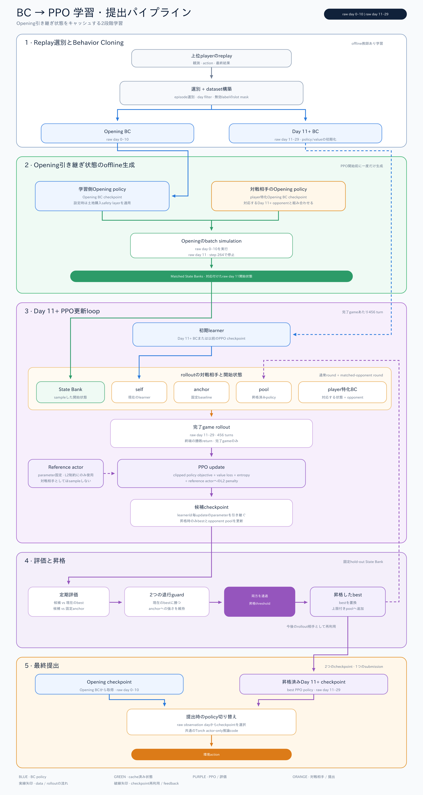
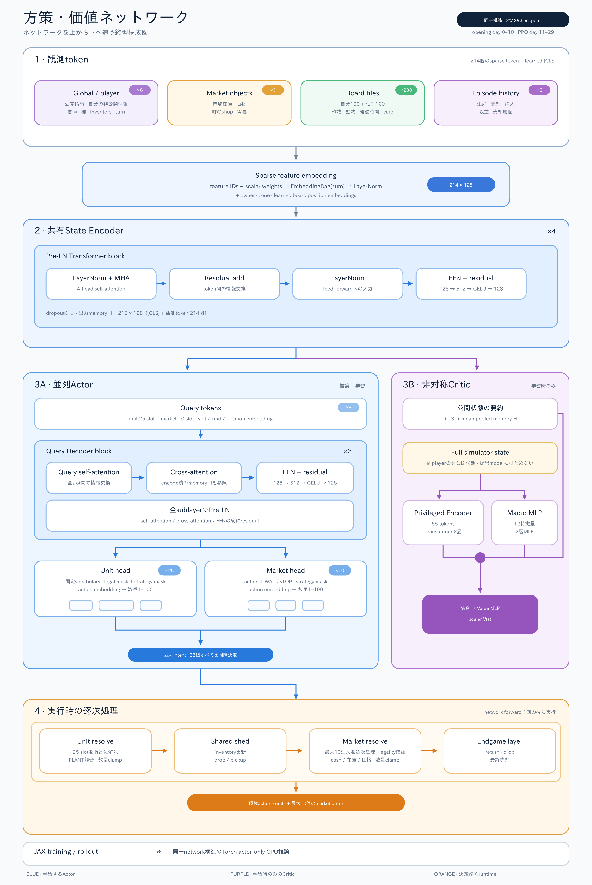

# [22位 (Gold)] 模倣学習と多様な対戦相手を用いたPPO

*上位プレイヤーのリプレイでBC fine-tuningしたモデルが、自分の継続PPOモデルに勝ち、それが金メダルを獲りました。*

## はじめに

上位プレイヤーのリプレイを用いたBehavior Cloning（BC）で方策を初期化し、その後PPOで改善しました。ただし、720ターンを最初から最後まで毎回シミュレーションする構成では学習コストが大きく、固定した相手との自己対戦だけでは戦略も偏ります。

そこで、序盤と中盤以降を別モデルに分け、序盤終了時の状態を事前生成し、複数の方策を対戦相手として使う構成を採用しました。本稿では、方策ネットワーク、BC、PPO、提出時の推論まで、実際に行ったことをまとめます。

実装は[GitHubリポジトリ](https://github.com/atsushi11o7/kaggriculture)で公開しています。

## TL;DR

- 表示上のday 1–11をOpeningモデル、day 12–30をDay 11+モデルに担当させました。
- 状態は128次元のtoken列に変換し、4層のTransformerで符号化しました。
- Actorは25個のunit slotと10個のmarket slotを並列に出力させ、Executorにゲーム状態を更新させながら順番に実行可能性を解決させました。
- CriticはActorと公開状態のencoderを共有させ、学習時だけ利用できる非公開情報とmacro特徴も参照させました。
- Openingモデルからday 12開始状態を事前生成し、PPOでは残り456ターンだけをrolloutしました。
- PPOの対戦相手にはself、固定anchor、過去checkpointのpool、プレイヤー特化BCモデルを混ぜました。
- 定期評価で現bestとanchorの両方に勝った候補だけをbestへ昇格させました。
- 最終的には、継続的にPPOし続けたモデル（LB 40〜50位程度）ではなく、PPOベースへ上位プレイヤーのリプレイでBC fine-tuningをかけたモデルの方が強く、こちらを提出して22位（金メダル）でした。

## 1. 全体構成

コード内部の`obs["day"]`は0始まりです。本稿では混乱を避けるため、必要に応じてraw dayとゲーム画面上のdayを併記します。

| 担当 | raw day | 画面上のday | ターン数 |
| --- | ---: | ---: | ---: |
| Openingモデル | 0–10 | 1–11 | 264 |
| Day 11+モデル | 11–29 | 12–30 | 456 |

この2段構成は、計算資源の制約から生まれたものです。RTX 5070 Ti 1枚だけで戦うつもりだったので、もし計算資源にもっと余裕があれば、序盤と中盤以降を分けずに1つのモデルで学習していたと思います。

計算量を抑えるため、まずOpeningの選択肢を減らすことにしました。上位プレイヤーの中でも、raw day 10までに4区画の土地を全て取り切るという戦略を取っているプレイヤーを選び、そのリプレイをBCで再現させることで、raw day 11以降の課題を「4区画の土地が全て使え、ある程度の資金と資源を持ったランダムな状態から、相手より多く稼ぐ」という、より単純な問題に絞り込みました。この単純化によって、PPOで学習する範囲をDay 11+モデルだけに限定できました。

この単純化が成り立つと判断した根拠は、リプレイ上で、序盤の行動が相手の戦略よりも町の出店状況や自分の資源状態に強く左右されていたことです。これはリプレイの探索的な集計に基づく判断ですが、相手の行動によって序盤の分岐が大きく変わる場面は比較的少なく見えました。そのため、序盤専用モデルで十分に再現できると判断しました。なお、Openingモデル自体には、他のモデルと同様に相手の公開状態も入力しています。相手情報を明示的に遮断しているわけではなく、あくまで学習データ・学習範囲を絞ったという意味です。

さらに計算量を削るため、PPOのたびにOpeningモデルを264ターン実行するのではなく、両プレイヤーのday 12開始状態をあらかじめ生成してstate bankへ保存することにしました。PPOではこのstate bankから状態を取り出し、残り456ターンだけを実行しました。提出時にはstate bankを使わず、raw day 0–10ではOpeningモデル、raw day 11–29ではDay 11+モデルを呼び分けました。

## 2. Policy / Value Network

### 2.1 状態表現

観測に含まれるglobal情報、player情報、盤面、shed、市場などを固定長のtoken列へ変換しました。疎な離散特徴は特徴ごとのembeddingとして表現し、同じentityに属するembeddingを加算して128次元のtokenを作りました。

token列の先頭にはglobal tokenを置きました。各tokenには種類や位置を表すembeddingも加え、padding部分はattention maskで除外しました。この列を4層、4 headsのpre-LayerNorm Transformerへ入力し、活性化関数にはGELUを使用しました。

この方式を選んだのは、盤面全体を大きなdense vectorへ潰すよりも、entity単位の構造を保ったまま相互作用を学習できると考えたためです。また、JAX版とTorch版で同じ前処理を再現しやすいという利点もありました。

### 2.2 並列Actorと逐次Executor

Actorは、25個のunit slotと10個のmarket slot、合計35個のqueryを一度に処理します。query同士のself-attentionと、状態tokenへのcross-attentionを通した後、それぞれのslotで操作、対象、数量などのlogitを出力させました。

全slotを1回のforward passで計算させたため、あるslotで選んだ行動によって後続slotの分布が変わる自己回帰モデルにはしませんでした。推論速度を保つ代わりに、サブアクション間の依存関係をネットワークだけで完全には表現できない設計です。

この不足はExecutorで補いました。Actorが出力したものを「実行候補のintent」とみなし、Executorに規定の順序で状態を更新させながら処理させました。共有在庫、所持金、数量上限、同一対象への操作、marketのSTOPなどを、その時点のshadow stateに基づいて解決させています。

この構成は、自己回帰モデルほど強い条件付き依存を表現できません。一方で、Transformerをslot数だけ繰り返す必要がなく、GPU上でまとめて計算できます。扱う必要があった依存関係の多くが「環境内で順番に実行すると状態が変わる」という制約に由来していたため、速度と実装の単純さのバランスを取りやすいこの設計を選びました。

### 2.3 合法maskとstrategy mask

Actorのlogitには、現在の観測から決定的に判定できる合法maskを適用しました。隣接していないshedへのPICKUP/DROP、在庫に無いitemのPICKUP、所持金が足りないBUY系の操作など、盤面と在庫から機械的に判定できる実行不能な操作をsampling対象から外しています。

合法性とは別に、試合終了までに利益を生まない投資などを抑えるstrategy maskも使用しました。具体的には、残り日数で初回生産が間に合わないPLANT・BUY_SEED・BUY_ANIMAL・BUY_LANDを候補から除外しています。一方、HIREのようにその場ですぐ効果が出る操作までは一律に禁止していません。合法maskがゲームルール上の可否を表すのに対し、strategy maskは私が採用した戦略上の制約です。この2つを分けることで、ルールの再現と戦略上のheuristicを混同しないようにしました。

ただし、複数slotの行動を並列に選ぶ以上、maskだけではターン内の競合をすべて防げません。最終的な整合性はExecutorに処理させています。

### 2.4 非対称Critic

Criticは、Actorと公開状態のTransformer encoderを共有しています。これに加えて、学習時だけ取得できる両プレイヤーの非公開状態を専用encoderで処理させ、試合全体を要約したmacro特徴と結合して価値を予測させました。

Actorには提出時に利用可能な情報だけで行動させましたが、Criticには学習時の完全状態を与え、価値推定を容易にすることを狙いました。非公開状態用encoder、macro MLP、value headは推論用の`.pt`へexportしていません。

提出用にexportしたActorの重みは、Opening・Day 11+のどちらも約203万（2.03M）パラメータでした。

### 2.5 JAXとTorchの対応

追加の計算リソースは借りず、RTX 5070 Ti 1枚で学習しました。そのため、限られた計算資源を高速化と並列化によって最大限活かす工夫として、シミュレーションとニューラルネットワーク学習の中核をJAXで実装し、GPU上でbatch実行しました。リプレイ解析やBCのcache作成、データ供給はCPU側の処理で、Python側のdata loaderがボトルネックになった時期もありました。提出時の推論だけはPyTorchへ重みを移植し、CPU環境で動かしました。

tokenizer、Transformer、query decoder、mask、Executorの意味は両実装で揃え、学習済みのActor重みをJAXからTorchへ変換しています。

## 3. Behavior Cloning

### 3.1 リプレイから固定shapeの教師を作る

BCでは、リプレイJSONをCPUで読み込み、各ターンの観測と行動を固定shapeの`State + Intent + episode history`へ変換しました。変換結果はepisode単位のshardとしてcacheし、学習時には必要なshardだけをprefetchしました。全データをRAMへ載せず、同じルールとリプレイ集合ならcacheを再利用できる構成にしています。

Openingモデルの学習データは2段階で絞り込みました。まず、締切の10日ほど前時点のリプレイのうち、raw day 10までに4区画の土地を取り切る戦略を取っている複数プレイヤーのデータでBCしました。その後、戦略の一貫性が高かった上位1プレイヤーのデータだけに絞ってfine-tuningしています。複数プレイヤーを混ぜたままだと同じ局面に異なる戦略の教師が現れるため、まず戦略の傾向でデータを絞り、最後に1人へ絞ることで教師の一貫性を優先しました。

初期の広域BCでは約5,700試合を、batch size 128で10 epoch、約64万step学習しました。その後は、4区画戦略を取るプレイヤー、さらに戦略の一貫性が高かった上位1プレイヤーへとデータを絞り、OpeningモデルとDay 11+モデルをそれぞれ追加学習しました。

### 3.2 無効行動をPASSとして学ばせない

初期の実装では、正規化によって無効な操作がPASSやWAITへ変換されると、それを正しい教師として扱ってしまう危険がありました。特に終盤は無効操作が増えるため、モデルが「終盤ではPASSを選ぶ」と誤って学習しやすくなります。

そこで、元の行動が明示的なPASSまたはWAITだった場合だけ、それらを教師として残すようにしました。無効行動が正規化の結果としてPASSまたはWAITになったslotは、そのslotのpolicy lossから除外しています。他のslotとvalue lossはそのまま学習に使用しました。

### 3.3 ActorとCriticの共同学習

BCでは、1回のforward passからpolicy lossとvalue lossを計算しました。

\[
L = L_{BC} + \lambda_v L_{value}
\]

共有encoderには両方の勾配を流しました。policy headはBC loss、非公開情報encoderとvalue headはvalue lossによって更新させています。value targetには完了試合の最終勝敗を使用し、完了していない試合はvalue学習から除外しました。

### 3.4 PPO checkpointをプレイヤーごとにBC fine-tuningする

複数の強いプレイヤーを無条件に混ぜると、似た局面に異なる戦略の教師が現れます。そこで、学習途中のPPO checkpointを初期値として、その時点で最新の上位プレイヤーのリプレイをプレイヤーごとに分けてBC fine-tuningし、複数の特化モデルを作成しました。PPOで得た方策を土台にしながら、各プレイヤーに一貫した戦略へ寄せることが目的です。

作成したプレイヤー特化モデルは重みを固定し、PPOに多様な戦略を経験させるための対戦相手として利用しました。

## 4. PPO

### 4.1 Opening state bank

Openingモデル同士、またはOpeningモデルとプレイヤー特化Openingモデルを対戦させ、raw day 11、すなわち画面上のday 12開始時点の完全なゲーム状態を保存しました。

state bankには自分側だけでなく、相手側の盤面、資産、市場状態も含めています。また、固定対戦相手用のbankでは、開始状態を生成したOpeningモデルとday 12以降を担当する相手モデルの対応をmanifestに記録し、取り違えを検出できるようにしました。

これにより、PPOは毎updateで序盤264ターンを再実行せず、後半456ターンへ計算資源を集中できるようにしました。

### 4.2 完了試合を蓄積して更新する

1 updateにつき、batch size 32のrolloutを2 round実行し、合計64試合を収集しました。各試合はday 12からday 30まで完走させ、各update内では学習側に同じbehavior policyを使い、相手方策を切り替えながら収集したtransitionからGAEとPPO lossを計算しました。

主な設定は次の通りです。

| 項目 | 値 |
| --- | ---: |
| rollout horizon | 456 |
| games / update | 64 |
| discount factor \(\gamma\) | 0.999 |
| GAE \(\lambda\) | 1.0 |
| PPO clip | 0.2 |
| learning rate | \(1\times10^{-5}\) |
| minibatch size | 128 |
| segment length | 72 |

報酬は終端の勝敗を中心にし、途中の日次報酬は使用しませんでした。長いhorizonの終端報酬を各時点へ伝えるため、\(\gamma\)を1に近づけ、GAE \(\lambda\)を1.0にしています。

### 4.3 対戦相手の多様化

2 roundのうち、一方では次の分布から相手を選びました。

- self: 現在の学習中方策
- anchor: 学習開始時に固定した基準方策
- checkpoint pool: 過去に昇格した方策

基本比率はself 25%、anchor 25%、pool 50%にしました。poolが空の期間は、その確率をanchorへ戻しています。

もう一方のroundでは、プレイヤー特化BCモデルを固定相手として使用しました。最終runでは、学習対象の戦略に近い特化モデルの重みを高くし、他の複数プレイヤーの特化モデルも混ぜました。土地を4区画取得する方策だけでなく、3区画で運用する方策も含めることで、単一の相手への過適応を抑えました。

この対戦相手プールは最初から今の形だったわけではありません。学習開始当初はselfとanchorだけで回しており、途中から、学習中のcheckpointに対してリーダーボード上で強い成績を残していたプレイヤーのデータで軽くBCしたモデルを、対戦相手として追加するようになりました。目的は、自己対戦だけでは出てこない戦略を相手に混ぜ、学習分布を広げることでした。

### 4.4 anchorとreferenceの役割

anchorとreferenceは、同じcheckpointを指す場合があっても異なる役割として使い分けました。

- **anchor**: 固定対戦相手および劣化判定の基準
- **reference**: Actorのパラメータが初期方策から離れすぎないようにするL2正則化の基準

anchorに勝てることを、元の方策より対戦性能が落ちていないかを確認する安全網として使いました。reference penaltyは、PPOの更新でBC方策が急激に崩れることを抑えるために入れています。

### 4.5 bestへの昇格

10 updateごとに、候補方策を独立した評価state bankで評価しました。プレイヤーIDによる偏りを避けるため、両側を入れ替えて各64試合、合計128試合を実行しています。

候補は、次の両条件を満たした場合だけbestへ昇格させました。

1. 現在のbestに対する勝率が55%以上
2. anchorに対する勝率が60%以上

昇格したcheckpointはbestを置き換え、checkpoint poolにも追加しました。poolは最大8件に制限しています。昇格しなかった場合も学習中のcandidate自体は更新を続けますが、bestとpoolは変更しません。

### 4.6 学習量

最終方策につながるPPOでは370 update（23,680試合、約1,080万player-turn）を学習し、約22時間を要しました。

試行錯誤を含むPPO全体では、runによって1 updateあたり64〜256試合、1試合あたり456〜720ターンと設定が異なります。対戦相手や開始状態、報酬設定を変更しながら、累計では約1,200 update、約10万試合、約5,000万player-turnを実行しました。

ただし、この累計値は異なる設定で行った試行を合算したものであり、同じ方策を一貫した条件で学習し続けた量ではありません。最終構成で連続して回せたのは上記の370 updateにとどまり、長いhorizonと大きな行動空間に対して、方策が十分に収束するまで学習量を確保できたとは言えません。対戦相手や開始状態を整えるまでにも多くの時間を使ったため、PPOの設計だけでなく、単純に最終設定での学習量が不足していた可能性があります。

## 5. 決定論的な補助レイヤ

学習方策の前後には、役割を限定した決定論的レイヤを置きました。

### 5.1 土地購入の安全網

Openingでは、所定の日付を過ぎ、購入後の運転資金も確保できる場合に、未購入の土地を市場注文の先頭へ挿入する安全網を使いました。これは序盤全体をrule-based agentへ置き換えるものではなく、Openingモデルの出力に対する限定的な補正として入れています。

提出時のTorch実装とstate bank生成時のJAX実装で、期限、必要資金、注文の挿入位置を揃えました。

### 5.2 終盤処理

終盤には、残り手数から逆算して、所持品をshedへ戻すための移動とDROPを必要な場合だけ強制させました。また、最終stepでは売却可能な在庫を市場へ出させています。

このレイヤは、価値を生まない移動を早い段階から一律にPASSへ置き換えるものではありません。帰還が間に合わなくなる境界と最終売却に限定しました。補正されたslotはBC/PPOのpolicy lossから除外し、モデル自身の選択として学習しないようにしています。

## 6. うまくいかなかったことと得られた知見

### 6.1 Openingをテープ(記録した手順の再現)で作る

Openingの動きは、最初はリプレイの手順をそのまま再現する、テープ的な方式で作ろうとしました。しかしうまく動かず、BCの方が実装と調整を進めやすく、実際の挙動も良かったため、Openingも含めてBCで作る方針に切り替えました。

### 6.2 全期間をそのままPPOする

720ターンを毎回rolloutすると、序盤のほぼ定型的な操作にも計算時間を使ってしまいました。さらに、長いepisodeを保持したまま勾配計算するとGPUメモリも圧迫しました。Opening state bankによって264ターンを事前計算へ移したことは、学習速度とメモリ使用量の両方に効きました。

### 6.3 市場注文を自己回帰的に生成する

市場注文を1件ずつ生成し、前の注文を次の入力へ戻す構成も試しました。注文間の依存関係を表現しやすい一方、slot方向の逐次計算がrollout速度を大きく下げることが分かりました。PPOでは環境遷移数を確保することも重要だったため、最終的には並列Actorと逐次Executorの構成へ戻しました。

### 6.4 無効行動をPASSへ畳み込む

無効な教師行動をPASSとして扱ったところ、損失自体は下がっても方策はPASSを過剰に選ぶようになりました。正規化後のラベルだけを見るのではなく、元の行動が明示的なPASSだったかを保持する必要がありました。

### 6.5 固定相手だけでPPOする

単一のanchorや直近bestだけを相手にすると、その方策への勝ち方に特化しやすくなることが分かりました。そこでself、anchor、過去checkpoint、複数のプレイヤー特化BCモデルを混ぜ、開始状態も相手方策に対応させることで、学習分布を広げました。

### 6.6 学習時と提出時の処理を揃える

土地購入、終盤処理、合法mask、ExecutorのどれかがJAXとTorchで異なると、offline評価が良くても提出時の行動は再現されませんでした。重み変換だけでなく、前処理と後処理を含む推論経路全体を一致させる必要がありました。

### 6.7 自己対戦で鍛えたPPOは、上位プレイヤーBCに最後追いつけなかった

締切間際まで、対戦相手プールのモデルを何度も入れ替えながらPPOを回し続けました。最後の実験で、PPOの重みへ新しく上位プレイヤーのリプレイでBC fine-tuningをかけた候補をいくつか作ったところ、その中に学習中のPPOが明確に勝ち越せないモデルが１つありました。このBC fine-tuningモデルを、継続的にPPOし続けた本線のモデルと並べて、2つ目の最終提出に選びました。

他の参加者のwriteupを見ても、上位プレイヤーのリプレイによるBCは強い結果を出していました。今回の計算予算、対戦相手構成、学習期間の範囲では、PPOが最後のBC fine-tuningモデルを明確に上回るところまでは到達しませんでした。PPOへ広げるよりも、BCのデータ選別や追加学習へ計算資源を集中させる方が有効だった可能性があります。

## 7. 最終提出

最終的に2つのcheckpointを提出しました。1つは継続的にPPOで更新し続けた本線のモデル、もう1つは6.7で触れた、PPOベースへ上位プレイヤーのリプレイでBC fine-tuningをかけたモデルです。

継続PPOの本線モデルはリーダーボード上で40〜50位程度にとどまった一方、BC fine-tuningモデルの方は22位（金メダル）となりました。

提出物には、Opening用とDay 11+用の2つのTorch checkpointを含めました。推論時はraw day 10までOpeningモデルを使用し、raw day 11からDay 11+モデルへ切り替えています。その後、土地購入の安全網と終盤レイヤを必要な条件で適用し、環境へ行動を返しました。

Criticは学習時だけ使用し、提出物にはActorの重みだけをexportしました。これにより、非公開情報へ依存せず、CPU環境で推論できるようにしています。

## おわりに

Kaggricultureでは、ネットワークを大きくすること以上に、どこを学習させ、どこを決定論的に処理し、どの分布から対戦データを集めるかが重要でした。

最終構成の要点は、次の3つです。

1. 序盤を別モデルとstate bankへ分離し、PPOの計算を戦略が分岐する区間へ集中させたこと
2. 複合行動を並列に予測させ、逐次Executorで環境上の依存関係を解決させたこと
3. 固定anchorだけでなく、self、過去checkpoint、異なる戦略のBCモデルを対戦相手にしたこと

一方で、これらの施策の多くは、限られた期間と資源の中で観測した問題に対して仮説を立て、逐次導入したものです。複数の変更を同時に加えた実験も多く、十分なablationを行えなかったため、どの施策がどの程度スコアへ寄与したかを明確に断定することはできません。本稿で紹介した構成は、個々の要素の有効性を厳密に証明した最適解ではなく、コンペ期間中の試行錯誤を経て最終的に採用した1つの設計です。

長いhorizon、複合離散行動、多様な対戦相手を持つシミュレーションでは、同じ考え方を再利用できると考えています。

## 謝辞

Kaggleとこのコンペを作ってくださった運営の皆様、そして対戦してくださった参加者の皆様に感謝します。ありがとうございました。
